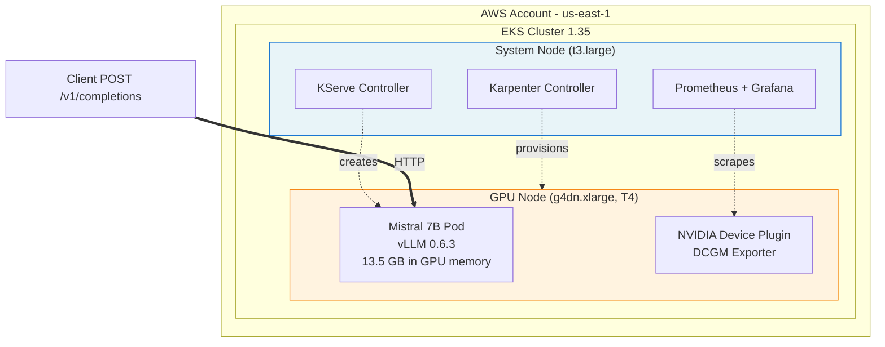

# Paved Road for AI Workloads: EKS + Karpenter + KServe + vLLM Reference Architecture

> *A production-shaped reference for serving open-source LLMs on EKS with GPU autoscaling. Full code: [paved-road-ai-eks on GitHub](https://github.com/arvind-platform-eng/paved-road-ai-eks)*

---

## 1. "Just use EKS for AI workloads" doesn't cut it

AI inference workloads break most of the mental models we've built for stateless web services on Kubernetes.

A typical API pod boots in under 10 seconds. Our Mistral 7B pod needs **5-10 minutes** just to download 15 GB of model weights and load them into GPU memory. Default liveness and readiness probes kill the container long before it finishes loading.

A typical EKS cluster scales nodes in minutes. Our GPU workload needs **scale-to-zero** (no requests = no GPU running) *and* fast scale-up when the first request arrives, because g4dn.xlarge spot instances cost about ₹13 per hour and A10G variants cost 3× that.

A typical container image is a few hundred megabytes. Our vLLM image is **5.4 GB** before it pulls the model.

Nothing about the standard EKS playbook anticipates this. You need:
- A GPU-aware autoscaler that can scale to zero (not Cluster Autoscaler)
- A model-serving layer with the right primitives (not raw Deployments)
- An inference engine built for GPU throughput (not Hugging Face Transformers)
- An observability layer that includes GPU metrics (not just CPU and memory)
- Terraform scaffolding that bakes in the invisible-blocker fixes nobody writes down

I spent 3 nights debugging my way to a working deployment. This post is the reference architecture I wish I'd had on day one. Every component choice is annotated with *why*, every hard-won gotcha is called out, and the full repo is public with every commit in the git log.

**First successful inference: 2026-10-15, 19:56 IST. Mistral 7B explaining Kubernetes to a 10-year-old:**

> *"Kubernetes is like a magician's assistant, helping many toy robots (applications) to work together smoothly on a big playing field (data center or cloud), making sure they stay healthy and play nicely with each other."*

Let's walk through how it's built.

---

## 2. Architecture at a glance

## 2. Architecture at a glance

Seven components, each chosen for a specific reason the next section will unpack. Here's the full stack:

| Layer | Component | What it does |
|---|---|---|
| Infrastructure | **EKS 1.35** | Managed control plane, VPC, system node group |
| Compute autoscaling | **Karpenter 1.6.0** | Provisions GPU nodes on-demand, scales to zero when idle |
| Model serving | **KServe + Knative Serving** | InferenceService CRD, OpenAI-compatible routing, request handling |
| Inference engine | **vLLM 0.6.3** | Mistral 7B inference with continuous batching + PagedAttention |
| GPU support | **NVIDIA device plugin** | Exposes GPU as `nvidia.com/gpu` allocatable resource |
| Observability | **kube-prometheus-stack + DCGM** | Prometheus metrics, Grafana dashboards, GPU-specific telemetry |
| Automation | **Terraform** | All of the above as infrastructure-as-code |

When no inference requests are coming in, Karpenter scales the GPU node to zero. The next request triggers a 3-5 minute cold start (node provisioning + model download), but idle cost drops to pennies per day instead of ₹115 per month for always-on.

For teams that need sub-second cold starts, you can keep `minReplicas: 1` on the InferenceService — but that locks in the GPU 24/7. The reference setup here uses scale-to-zero because that's the harder (and more cost-effective) default to get right.

The entire stack is reproducible via `terraform apply` plus a single AI-stack bootstrap script. Fresh deploy to serving model takes ~45 minutes end-to-end when nothing is broken (ask me how I know).

---

## 3. Key design decisions (the "why" behind each component)

Every component in Section 2 competes with 2-3 alternatives. Here's the *why* behind each pick, framed the way I'd defend them in a design review.

### Why Karpenter, not Cluster Autoscaler

Cluster Autoscaler works at the node-group level — you define groups ahead of time, it scales within them. For AI workloads this is painful: you want a GPU node *only* when inference traffic arrives, and want it gone the moment traffic stops. Pre-provisioning a GPU node group with `minSize: 0` works, but scale-up is slow and you're locked to one instance type.

Karpenter provisions nodes from a NodePool spec at pod-schedule time. One NodePool can describe "any of g4dn.xlarge, g5.xlarge, g6.xlarge, on-demand or spot, in any AZ" — Karpenter picks the cheapest available match for the pending pod. Scale-to-zero is automatic when the node is idle for a configurable window.

For a project where GPU time is 90% of total AWS spend, this is the difference between ₹115/month idle cost and ~₹10.

### Why KServe + Knative Serving, not a raw Deployment + Service

I could run vLLM in a plain Deployment behind a ClusterIP Service and call it done. KServe adds three things worth the operational complexity:

1. **InferenceService CRD** — a single YAML with model, resources, autoscaling, and traffic policy. Reads like intent, not plumbing.
2. **OpenAI-compatible routing** — `/v1/completions`, `/v1/chat/completions`, `/v1/models` work out of the box because KServe knows how to front vLLM.
3. **Request-queue aware autoscaling via Knative** — scales on concurrent requests, not just CPU. The right signal for inference workloads.

Trade-off: KServe reconciliation sometimes injects default probes you don't want (see gotcha 4.2). Worth it on balance.

### Why vLLM, not Hugging Face Transformers

Transformers' `pipeline()` is the "hello world" of local inference. For serving, it hits a wall quickly: no request batching, no KV cache sharing, no PagedAttention. One request at a time.

vLLM adds *continuous batching* — new requests join the running batch mid-generation — and PagedAttention, which lets KV cache memory be allocated in pages like virtual memory. Together, 10-20× throughput on the same GPU for concurrent workloads.

For a 1-user demo, this doesn't matter. For a serving platform, it's the whole game.

### Why T4 (g4dn.xlarge), not A10G (g5.xlarge)

A10G is faster. Also 3× the cost. On-demand pricing in us-east-1:

- `g4dn.xlarge` (T4, 16 GB): **$0.526/hr** on-demand, **~$0.1578/hr spot**
- `g5.xlarge` (A10G, 24 GB): **$1.006/hr** on-demand, **~$0.302/hr spot**

For a 7B model with 4096-token context serving < 20 concurrent users, T4 is fine. Mistral 7B in float16 fits in 13.5 GB with ~800 MB KV cache headroom. Throughput: 50-80 tokens/sec at a single request, more with batching.

Pick A10G when you need bigger models (13B+), long context (16k+), or high concurrency. Default to T4 for everything else and bank the savings.

---

## 4. Non-obvious gotchas (the stuff tutorials skip)

Every one of these is a story from the git log. If you clone the repo and read `JOURNAL.md`, you'll find the exact commit that fixed each. In production you'll hit the same list — I'm just saving you the nights.

### 4.1 EKS silently rejects nodes whose IAM role isn't in the access-entries list

Karpenter launched a g4dn.xlarge GPU node. The EC2 instance booted cleanly. Kubelet started. NVIDIA driver loaded. The node console output showed every step succeeding. But `kubectl get nodes` never showed it joining the cluster. Three nights of debugging later: EKS replaced the old `aws-auth` ConfigMap flow with the access-entries API, and Karpenter's node IAM role wasn't in the authorized principals list. EKS silently refused the kubelet's join request — no error anywhere obvious. Fix: an `aws_eks_access_entry` resource for the Karpenter node role, baked into the Terraform karpenter module so it survives every destroy/apply cycle. Commit: `fix(karpenter): add EKS access entry + IAM instance profile permissions`.

### 4.2 KServe injects a default readinessProbe that kills long model loads

Pod scheduled on GPU, container started, vLLM began loading 15 GB of model weights from Hugging Face. At ~2-3 minutes in, container got SIGTERMed and restarted. Loop forever. Root cause: KServe generates a Deployment with a default `readinessProbe: failureThreshold=3, periodSeconds=10` (30-second window) when the InferenceService spec omits probes. Model needs 5-10 minutes to load on T4. Probe fires, pod marked unhealthy, container killed. Fix: explicitly set *only* a `startupProbe` with a 15-minute window (90 failures × 10 sec), and leave readinessProbe/livenessProbe out entirely. In KServe RawDeployment mode, this is respected and no defaults are injected. Live `kubectl patch` to remove the probe doesn't stick — the operator reconciles it back within 60 seconds, so the fix has to live in the manifest file.

### 4.3 T4 GPUs can't run bfloat16 (compute capability 7.5)

ValueError on vLLM startup: *"Bfloat16 is only supported on GPUs with compute capability of at least 8.0. Your Tesla T4 GPU has compute capability 7.5."* Root cause: vLLM defaults to bfloat16 when PyTorch supports it, which assumes Ampere+ generation GPUs. T4 is Turing — compute 7.5, no bfloat16 support, only float16. Fix: `--dtype half` in vLLM args. Quality is imperceptibly different at inference. The lesson generalizes: before picking any precision setting (fp8, int8, bfloat16, float16), check your GPU's compute capability against NVIDIA's matrix at [developer.nvidia.com/cuda-gpus](https://developer.nvidia.com/cuda-gpus). Framework defaults assume newer hardware than you probably have.

### 4.4 KV cache math on 16 GB T4 is on a knife's edge

Model weights loaded successfully — logs showed `Loading model weights took 13.5083 GB`. Then vLLM crashed: *"ValueError: No available memory for the cache blocks. Try increasing gpu_memory_utilization when initializing the engine."* Mistral 7B in float16 is 13.5 GB. T4 has 16 GB. At vLLM's default `--gpu-memory-utilization=0.9`, vLLM caps itself at 14.4 GB total, leaving ~1 GB for KV cache after weights plus CUDA runtime overhead. Not enough for even one token of context. Fix: bump to `--gpu-memory-utilization=0.95` (5% headroom instead of 10%) AND cap `--max-model-len=4096` instead of vLLM's default 8192. Together these yield ~800 MB of KV cache headroom — enough to serve 4K context windows reliably. If you need the full 8K context, you need a bigger GPU. T4 with 7B models operates at the memory edge; every parameter affects the math.

### 4.5 NVIDIA device plugin installs cleanly but doesn't register the GPU

GPU node joined the cluster, carried the `nvidia.com/gpu.present=true` label, and the NVIDIA device plugin pod showed `Running`. But `kubectl describe node` showed *no* `nvidia.com/gpu` entry in Capacity or Allocatable. Pods requesting GPU stayed Pending forever with "Insufficient nvidia.com/gpu." Two root causes to check: (1) the NVIDIA DaemonSet needs an explicit toleration for the `nvidia.com/gpu:NoSchedule` taint — without it, the plugin pod can't land on the GPU node and no GPU gets registered with kubelet. (2) The install itself can silently partially fail inside a multi-step shell script if any `kubectl apply` has a bash parse issue — always verify explicitly with `kubectl get pods -n kube-system | grep nvidia` and `kubectl describe node | grep nvidia.com/gpu`. Label presence is not the same as allocatable resource. Confirm both.

### 4.6 vLLM's auto tokenizer-mode falls back badly for Mistral

Container started, model weights downloaded fine, then crashed with: *"TypeError: expected str, bytes or os.PathLike object, not NoneType"* in `tokenization_llama.py`'s `get_spm_processor`. Mistral ships both a fast tokenizer (`tokenizer.json`) and a slow SentencePiece tokenizer (`tokenizer.model`). vLLM's default `--tokenizer-mode=auto` tries fast first, falls back to slow when fast misbehaves, but the slow loader expected `self.vocab_file` to be set and it wasn't. Fix: `--tokenizer-mode mistral` in vLLM args — uses Mistral's native tokenizer path, bypassing the Hugging Face fallback chain entirely. The lesson: never trust "auto" settings in inference engines on newer models. Pick the explicit mode that matches your model family, even when auto *should* work.

---

## 5. Cost + observability

### The scale-to-zero math

For a 24/7 always-on serving setup, the GPU node cost dominates:

- `g4dn.xlarge` on-demand: **$0.526/hr × 730 hrs ≈ $384/month** (₹32,000)
- `g4dn.xlarge` spot (us-east-1): **$0.1578/hr × 730 hrs ≈ $115/month** (₹9,600)

With Karpenter's scale-to-zero, the GPU runs only when inference traffic arrives. For a demo portfolio project or a low-traffic internal tool, that's often <2 hours per day:

- Spot pricing × 2 hrs/day × 30 days = **~$9.50/month** (₹800)

A 92% cost reduction vs always-on spot, 97% vs always-on on-demand. The system node baseline (two `t3.large` nodes running the control-plane adjacent workloads) adds ~$60/month regardless, so total project cost at low traffic lands around **₹5,500-6,500/month**. That's the number I quote on invoices for consulting work.

Cold start cost: every "wake up" takes 3-5 minutes (Karpenter provisioning + model load). Fine for internal tools, unacceptable for user-facing products — for those, keep `minReplicas: 1` and accept the full idle cost.

### Observability layer

The kube-prometheus-stack chart ships Prometheus, Grafana, Alertmanager, and node-exporter out of the box. On top of that, this reference adds:

- **DCGM exporter** (NVIDIA's GPU metrics daemon) — exposes `DCGM_FI_DEV_GPU_UTIL`, `DCGM_FI_DEV_FB_USED`, `DCGM_FI_DEV_GPU_TEMP`, and ~40 other GPU-specific metrics scraped automatically by Prometheus.
- **vLLM `/metrics` endpoint** — scraped to collect token throughput, request latency percentiles, running request count, and KV cache utilization. These are the metrics that actually tell you if the system is healthy.

Three dashboards worth importing immediately:
- **12239** — NVIDIA DCGM Exporter Dashboard (GPU utilization, memory, temperature)
- **20398** — Karpenter dashboard (node provisioning, pod scheduling latency)
- Grafana Explore → query `DCGM_FI_DEV_GPU_UTIL` as a sanity check that metrics are flowing

The screenshot above shows GPU utilization climbing to 100% during model inference, confirming vLLM is actually using the hardware you're paying for. That's a surprisingly common bug — people forget to install the device plugin or request the GPU resource, and vLLM silently falls back to CPU at 50× slower throughput.

---

## 6. Takeaways + what's next

### Three things I'd tell past-me

**Audit your scaffolds before you build on them.** Half the gotchas in Section 4 came from scaffolded Terraform modules and ApplicationSet templates that worked for the author's exact cluster version six months ago and silently broke for mine. Before trusting any starter template, read every file, every CRD it installs, every image tag it references. Pin versions. Verify after apply, don't assume.

**Probes are not one-size-fits-all.** Default Kubernetes probe timings (30-second liveness, 10-second readiness) were designed for stateless web services that boot in seconds. LLM inference containers with multi-gigabyte model loads need either long `startupProbe` windows (15+ minutes) or no readiness/liveness probes during initial load. Picking the right probe strategy for the workload type is a design decision, not a default.

**Invest in Terraform IaC early, not late.** The second time I had to re-run a manual `aws iam put-role-policy` fix after `terraform destroy`, I knew it belonged in the module. Every manual fix that doesn't survive a destroy/apply cycle is a time bomb for your next session. If you fix it twice with a CLI command, commit it to Terraform the third time.

### What's next for this platform

The reference as it stands serves one model at low concurrency. Natural next investments:

- **Multi-model serving** — multiple InferenceService resources on the same cluster, sharing the Karpenter NodePool, scheduling by model priority
- **GPU-utilization-based HPA** — scale replicas on `DCGM_FI_DEV_GPU_UTIL` instead of CPU; the right signal for inference workloads
- **Istio service mesh** — mTLS between services, canary deploys for new model versions
- **ArgoCD GitOps for the AI stack** — currently installed directly via Helm; moving to ApplicationSet with sync-waves cleans up the deploy story
- **Spot interruption handling** — Karpenter has an SQS queue for interruption notices, but the vLLM pod needs a `preStop` hook that drains in-flight requests gracefully

### Clone, deploy, star

Full repo with every commit visible: **[github.com/arvind-platform-eng/paved-road-ai-eks](https://github.com/arvind-platform-eng/paved-road-ai-eks)**

The `JOURNAL.md` is more valuable than this blog post. Read it when you hit a wall.

If this saved you a night, star the repo. If you build something interesting on top of it, open an issue — I'd love to hear about it.

---

---

*Found this useful? [Star the repo on GitHub](https://github.com/arvind-platform-eng/paved-road-ai-eks) and follow me on LinkedIn for more platform engineering deep-dives.*

*Published on [careeractionplan.com](https://careeractionplan.com)*

*Arvind Kumar — Lead Platform Engineer with 15+ years running Kubernetes at scale (EKS, ECS Fargate), SRE patterns, and production infrastructure. Writing weekly at [careeractionplan.com](https://careeractionplan.com) · Connect on [LinkedIn](https://www.linkedin.com/in/arvindkumar-engg/) · Code on [GitHub](https://github.com/arvind-platform-eng).*